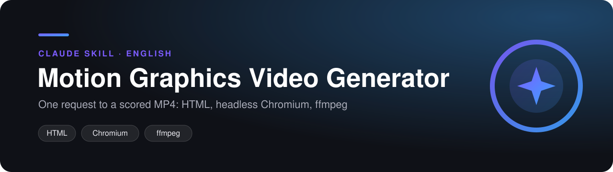

<p align="center"></p>

<p align="center">
  
  
  
</p>

<p align="center"><b>One request to a scored MP4: HTML, headless Chromium, ffmpeg</b></p>

---

## ✨ What it does

A Claude skill that produces an animated MP4 with music (9:16 Reels or 16:9) from a single request, with no editing software or stock footage. A frame-deterministic HTML/JS scene is captured frame by frame in headless Chromium, encoded with ffmpeg, and paired with music synthesised in Python.

- **Deterministic:** every element is computed from the frame number (`window.renderFrame(f)`), so any frame can be re-rendered exactly.
- **Tested templates:** `scene.html`, `render.js`, `audio.py` ship in each language folder.
- **Workflow:** second-by-second scene plan → 3–4 preview frames → full render → ffprobe and frame check.
- **Revisions by timecode:** "make the counter at 0:07 slower".

## 🧾 Example output

```bash
npm i playwright && npx playwright install chromium
node render.js scene.html video.mp4 30
python3 audio.py music.wav 3
ffmpeg -y -i video.mp4 -i music.wav -c:v copy -c:a aac -b:a 192k -shortest final.mp4
```
Verified before publishing: 90 frames, 1080×1920, 3.0 s MP4.

## 💬 How to use

Once installed, just ask Claude in plain language:

> "Make a 15-second Reel: 5,126 prototypes counting up, then the Dyson logo moment."  
> "Kinetic typography video of this quote, 9:16, bold and minimal."  
> "At 0:07 make the counter slower."  

## ⚙️ Install

**Claude Code**
```bash
git clone https://github.com/erencalik/motion-graphics-video-generator-claude.git ~/.claude/skills/motion-graphics-video-generator
```
**claude.ai:** download the repo as a ZIP (Code → Download ZIP) and upload it under Settings → Capabilities → Skills.

<details>
<summary>Files</summary>

| | |
|---|---|
| `SKILL.md` | the skill itself |
| `scene.html · render.js · audio.py` | tested templates (scene, frame renderer, music synth) |
| `README.md` | this page |
| `assets/banner.svg` | banner |
| `LICENSE` | MIT |

</details>

## 🔗 Works well with

| Repo | What it does |
|---|---|
| [`is-hikayesi-icerik-uretici-claude`](https://github.com/erencalik/is-hikayesi-icerik-uretici-claude) | Şirket ve kurucu hikayelerinden doğrulanmış carousel ve Reels |
| [`video-render-qa-gate-claude`](https://github.com/erencalik/video-render-qa-gate-claude) | Hang-proof rendering and a pre-delivery quality gate |

All skills and how they connect: [`claude-skills-collection`](https://github.com/erencalik/claude-skills-collection)

## 📄 Credits & license

Based on the method in Michael Ly's guide [How to Generate Motion Graphics Videos with Claude](https://milleemd.com/guides/motion-graphics-videos); the code templates were written for this skill. MIT licensed, see [LICENSE](LICENSE).
